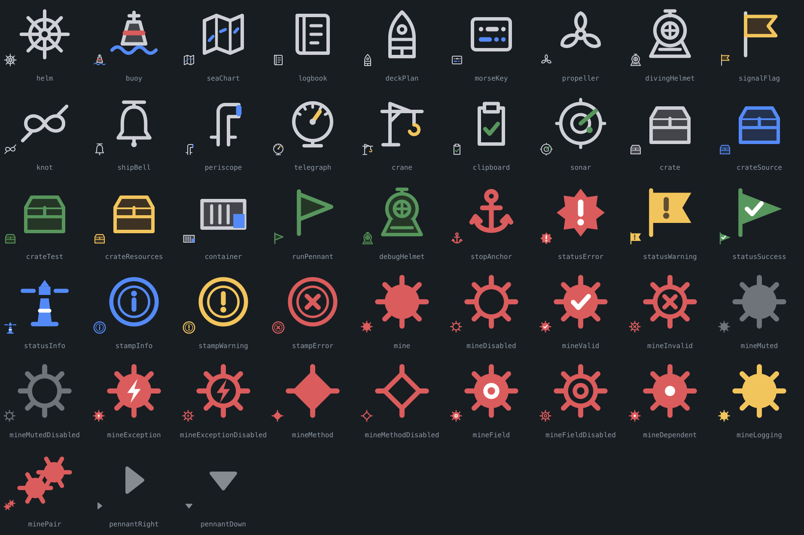

# Warden Navy

Two dark IntelliJ Platform themes inspired by the Warden navy of the game Foxhole.

| Theme | Mood |
|---|---|
| **Warden Navy Blacksteele** | Gunmetal hull, wooden deck, banner blue |
| **Warden Navy Nakki** | Deep water, sonar green, periscope glass |

Fan-made. Not affiliated with or endorsed by Siege Camp. All artwork in this repository is original.

## What is themed

- **IDE chrome**: every component, recoloured through the colour ramps of the parent theme *Islands Dark*.
- **Editor colour scheme**: syntax, inspections, diff, VCS, debugger, console and terminal colours.
- **Background artwork**: a sonar display with a warship or submarine, faint behind the code and stronger in the empty frame.
- **Icons**: 45 nautical icons. Breakpoints are sea mines, folders are crates, tool windows get a sea chart, logbook, ship's bell, periscope and more. Platform icons take the palette colours.
- **Progress bar**: a ship (Blacksteele) or a submarine running awash (Nakki) makes its way along the water. For indeterminate progress it crosses the bar again and again.
- **Air bubbles**: a few bubbles rise from the caret when you pause typing.
- **Torpedo**: deleting a line (*Delete Line*) sends a torpedo along it.
- **Sonar ping**: when a build or a run finishes, rings spread across the sonar display, green on success and red on failure.
- **Depth gauge**: a status bar widget that shows how deep the caret is in the file, one metre per line. Hide it from the status bar's context menu.

The effects play for a second or two and leave nothing running in between. Each can be switched off under **Settings | Appearance & Behavior | Warden Navy**; all are off in Power Save Mode.

## Build

Requires JDK 25.

```sh
./gradlew buildPlugin   # ZIP in build/distributions
./gradlew runIde        # sandbox IDE with the plugin installed
./gradlew verifyPlugin  # JetBrains Plugin Verifier
```

To watch the effects without typing or building, start the sandbox with
`IDE_JVM_ARGS="-Dwardennavy.demo=bubbles,torpedo,ping" ./gradlew runIde`; it replays them every few seconds.

Install the ZIP via **Settings | Plugins | ⚙ | Install Plugin from Disk…**, then pick a theme under **Settings | Appearance & Behavior | Appearance**.

## How the themes are generated

Colours live in `palettes/<variant>.properties`. The build expands every palette through the templates in `src/main/templates` into one UI theme (`*.theme.json`) and one editor colour scheme (`*.xml`). To add a variant, add a palette file and a `themeProvider` entry in `src/main/resources/META-INF/plugin.xml`.

## Artwork

The background images are drawn as SVG in `art/` and rendered to `src/main/resources/images`:

```sh
scripts/render-art.sh   # needs rsvg-convert (librsvg)
```

How strongly the artwork shows is set by `transparency` under `background` (behind the editor) and `emptyFrameBackground` in `src/main/templates/WardenNavy.theme.json`.

The icons are drawn by `python3 scripts/draw-icons.py`, which also writes `src/main/icons.json`, the list of platform icons they replace. Add `--overview` to refresh the sheet below.



`scripts/contrast.py` checks every palette against WCAG contrast ratios.
