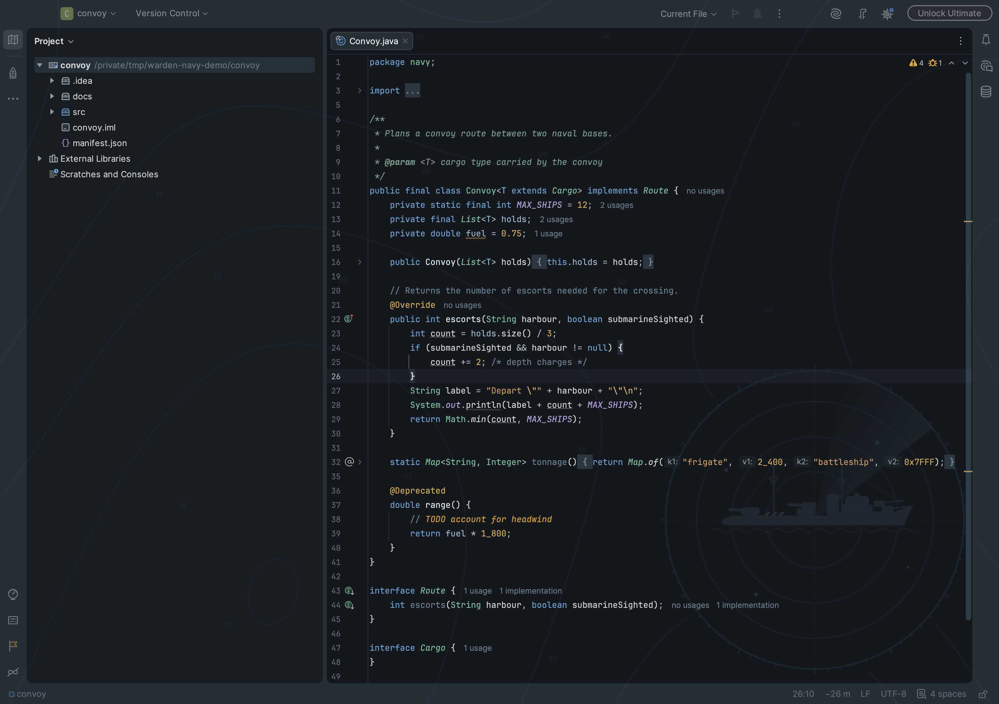
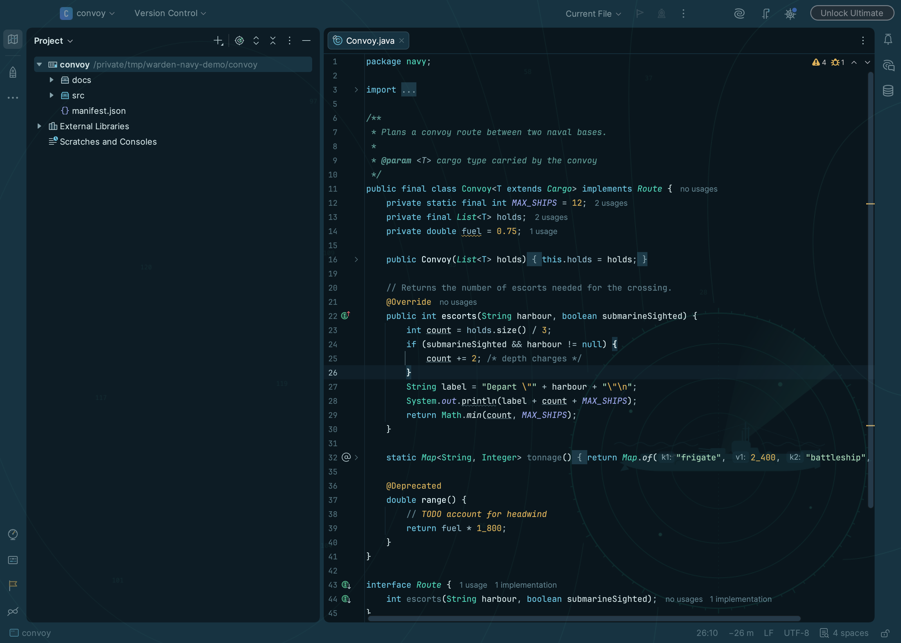
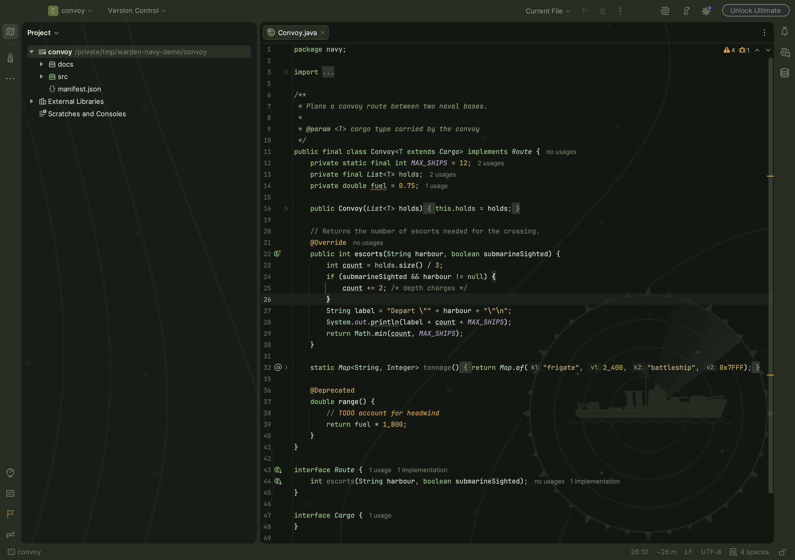
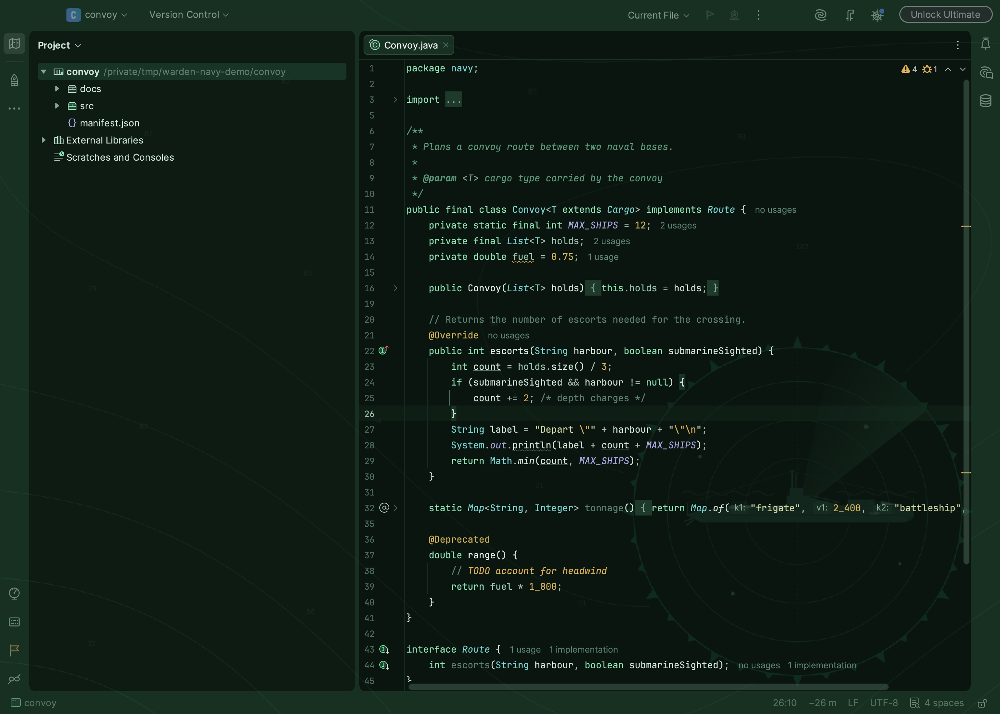
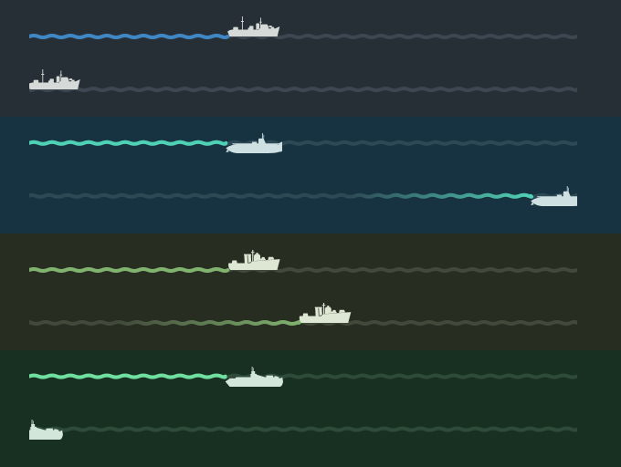
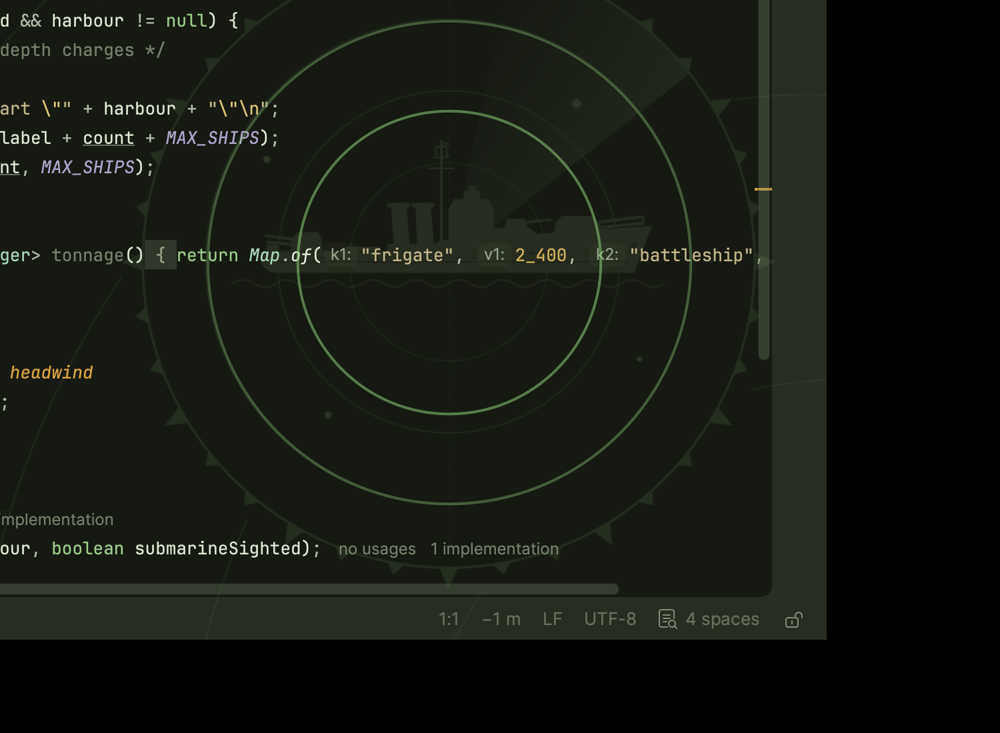
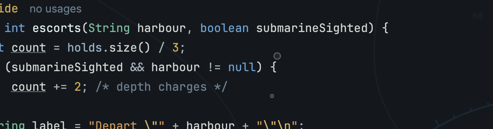
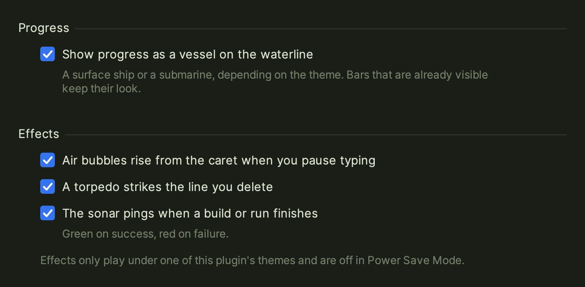

# Warden & Colonial Navy

Four dark themes for IntelliJ-based IDEs, inspired by the two navies of the game Foxhole. Each faction gets a surface ship and a submarine.

| Theme | Mood |
|---|---|
| **Warden Navy Blacksteele** | Gunmetal hull, wooden deck, banner blue |
| **Warden Navy Nakki** | Deep water, sonar green, periscope glass |
| **Colonial Navy Conqueror** | Khaki steel, Colonial green, ochre |
| **Colonial Navy Trident** | Deep green water, sonar mint, pale deck paint |









This is a fan project. It is not affiliated with or endorsed by Siege Camp. See [Licence and disclaimer](#licence-and-disclaimer).

## Install

Requires an IntelliJ-based IDE, version 2026.2 or newer (IntelliJ IDEA, PyCharm, WebStorm, Rider and the others).

1. Download `warden-colonial-navy-<version>.zip` from the [latest release](https://github.com/HaasFynn/foxhole-navy-intellij-themes/releases/latest). Do not unpack it.
2. In the IDE, open **Settings | Plugins**, click the gear icon and choose **Install Plugin from Disk…**. Select the ZIP.
3. Pick a theme under **Settings | Appearance & Behavior | Appearance**.

**Coming from Warden Navy 1.0.0?** Version 2 is a new plugin as far as the IDE is concerned. Uninstall *Warden Navy* first, otherwise the Warden themes show up twice. Your chosen theme and the plugin's switches need to be set again.

## What you get

- **IDE and editor colours**: every part of the IDE, plus syntax, inspections, diff, version control, debugger, console and terminal.
- **Background**: a sea chart with depth contours and soundings runs faintly behind the code and the tool windows, with a sonar display in the corner that shows the theme's vessel: the Blacksteele frigate, the Nakki submarine, the Conqueror destroyer or the Trident submarine.
- **Icons**: 45 nautical icons. Breakpoints are sea mines, folders are crates, and the tool windows get a sea chart, a logbook, a ship's bell, a periscope and more.

  

- **Progress bar**: the theme's vessel makes its way along the water, the submarines running awash.

  

- **Sonar ping**: when a build or a run finishes, rings spread across the sonar display, green on success and red on failure.

  

- **Air bubbles**: a few bubbles rise from the caret when you pause typing.

  

- **Torpedo**: *Delete Line* sends a torpedo along the line to the left, where it goes off against the edge of the editor.
- **Telegram notifications**: balloons look like radio telegram slips, paper-toned with a brass edge.
- **Depth gauge**: a status bar widget that shows how deep the caret is in the file, one metre per line.

## Settings

The effects play for a second or two and leave nothing running in between. Each one, and the progress bar, can be switched off under **Settings | Appearance & Behavior | Warden & Colonial Navy**. All effects are off in Power Save Mode. The depth gauge can be hidden from the status bar's context menu.



Everything except the colours only applies while one of the four themes is active.

## Build from source

Requires JDK 25.

```sh
./gradlew buildPlugin   # ZIP in build/distributions
./gradlew runIde        # sandbox IDE with the plugin installed
./gradlew verifyPlugin  # JetBrains Plugin Verifier
```

To watch the effects without typing or building, start the sandbox with
`IDE_JVM_ARGS="-Dnavy.demo=bubbles,torpedo,ping" ./gradlew runIde`; it replays them every few seconds.

### How it is put together

- **Colours** live in `palettes/<variant>.properties`. The build expands every palette through the templates in `src/main/templates` into one UI theme (`*.theme.json`) and one editor colour scheme (`*.xml`). To add a variant, add a palette file and a `themeProvider` entry in `src/main/resources/META-INF/plugin.xml`. `scripts/contrast.py` checks every palette against WCAG contrast ratios.
- **Artwork**: the sonar displays in `art/` are written by `scripts/draw-sonar.py`, and the sea chart around them by `scripts/draw-chart.py`. `scripts/render-art.sh` renders both to `src/main/resources/images` (needs `rsvg-convert` from librsvg). How strongly the artwork shows is set by `transparency` under `background` and `emptyFrameBackground` in `src/main/templates/Navy.theme.json`.
- **Icons** are drawn by `python3 scripts/draw-icons.py`, which also writes `src/main/icons.json`, the list of platform icons they replace. Add `--overview` to refresh `docs/icons.png`.
- **Effects, progress bar and depth gauge** are Kotlin code under `src/main/kotlin`.

## Licence and disclaimer

The code and all artwork in this repository are released under the [MIT Licence](LICENSE). All artwork was drawn for this project. The vessels are original drawings made with the ships in the game as reference; the repository contains no assets from the game.

Warden & Colonial Navy is an unofficial fan project. It is not affiliated with, endorsed by or sponsored by Siege Camp. Foxhole and the names of its factions and vessels are the property of their respective owners and are used here only to describe what inspired the themes.
